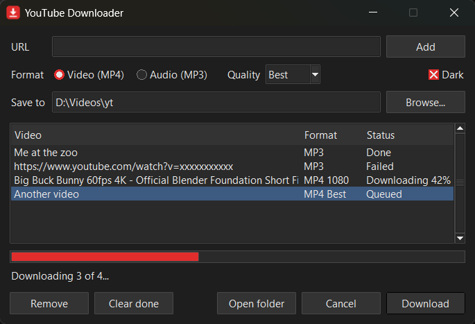

# YouTube to MP4 Downloader

A small desktop tool that downloads YouTube videos as MP4, or just their audio as MP3.
It is a single executable with nothing to install: Python, [yt-dlp](https://github.com/yt-dlp/yt-dlp),
ffmpeg and Deno are all packed inside. Double-click it for a window, or run it from a terminal
with options.



## Features

- **MP4 video or MP3 audio.** Video is saved as H.264 + AAC where YouTube offers it, so the file
  plays everywhere; audio is converted to MP3 at the highest variable-bitrate setting.
- **Quality limit.** Take the best available, or cap the height at 2160, 1440, 1080, 720, 480 or 360.
- **Download queue.** Add as many links as you like; they download one after another, each with
  its own format, status and title. You can keep adding while it runs.
- **Playlists.** A playlist link opens a list of its videos so you can tick the ones you want.
- **Cancel and retry.** Cancel stops the current download and removes its partial file. Pressing
  Download again resumes the queue and retries anything that failed or was cancelled.
- **Remembers where you were.** The unfinished queue, the save folder, the format and the theme
  come back the next time you open it.
- **Dark mode.** Follows the system theme on first launch (Windows and macOS), with a checkbox to switch.
- **Command line.** The same executable works in scripts and terminals.
- **Portable.** One file, no installer, no admin rights.

## Get the executable

Download the file for your system from the
[latest release](https://github.com/arthurotieno/YouTube-to-MP4-Downloader/releases/latest):

| System | File |
| --- | --- |
| Windows 10/11 | [`ytmp4-windows.exe`](https://github.com/arthurotieno/YouTube-to-MP4-Downloader/releases/latest/download/ytmp4-windows.exe) |
| macOS (Apple Silicon) | [`ytmp4-macos`](https://github.com/arthurotieno/YouTube-to-MP4-Downloader/releases/latest/download/ytmp4-macos) |
| Linux (x86-64) | [`ytmp4-linux`](https://github.com/arthurotieno/YouTube-to-MP4-Downloader/releases/latest/download/ytmp4-linux) |

There is nothing to install: put the file anywhere and run it. You can rename it to `ytmp4`
(`ytmp4.exe` on Windows), which is the name the examples below use.

The Windows version has been tested by hand. The macOS and Linux versions are built from the same
code and checked to start, but have had no hands-on testing yet; please report problems as issues.
Intel Macs are not covered by the release; build from source there.

### How releases are made

`.github/workflows/build.yml` builds all three executables on GitHub's machines, because an
executable can only be built on the system it is for. Pushing a tag such as `v1.1` builds them and
attaches them to a new release. Running **Build executables** by hand from the **Actions** tab
builds them as downloadable artifacts without making a release.

### Build it yourself

You need Python 3.10 or newer. On Linux, tkinter is a separate package
(Debian/Ubuntu: `sudo apt install python3-venv python3-tk`).

Windows:

```bat
build.bat
```

macOS and Linux:

```sh
sh build.sh
```

The executable is written to the `dist` folder. The first build downloads the dependencies into
a local `.venv` folder; nothing is installed system-wide.

## Using the window

Start the program with no arguments (double-click it).

1. Paste a YouTube link into **URL**. Several links separated by spaces or new lines are added together.
2. Choose **Video (MP4)** or **Audio (MP3)**, and a **Quality** for video.
3. Choose where to save with **Browse...** (the default is a `downloads` folder next to the program).
4. Press **Download**. Or press **Add** (or Enter) to queue the link and carry on adding more first.

Each row in the queue shows its own status. While it runs:

- **Cancel** stops the current download; the rest stay queued.
- **Remove** (or the Delete key) drops the selected rows. **Clear done** drops finished ones.
- A row marked **Failed** does not stop the queue. Click it to see the reason.
- **Open folder** opens the save folder.

### Playlists

Paste a playlist link, or a video link that contains `&list=`. After a moment a **Choose videos**
window lists every video with its length. Click a row to tick or untick it, or use
**Select all** / **Select none**, then press **Add selected**. Each chosen video becomes its own
row in the queue. Private and deleted videos start unticked.

### On macOS and Linux

- Make the file executable once: `chmod +x ytmp4`.
- macOS blocks unsigned downloads. The first time, right-click the file and choose **Open**, or run
  `xattr -d com.apple.quarantine ytmp4`.
- Starting it by double-click on macOS also opens a Terminal window; it can be ignored.

## Using the command line

```
ytmp4 URL [URL ...] [-o FOLDER] [-q HEIGHT] [-a] [-i ITEMS]
```

| Option | Meaning |
| --- | --- |
| `-o`, `--output FOLDER` | Where to save. Default: `downloads` in the current folder |
| `-q`, `--quality HEIGHT` | Maximum video height, e.g. `1080` or `720`. Default: best available |
| `-a`, `--audio` | Download just the audio as MP3 |
| `-i`, `--items LIST` | Which videos of a playlist to download, by position, e.g. `1,3,5-7`. Default: all |

Examples (on Windows use `ytmp4.exe`; on macOS and Linux `./ytmp4`):

```sh
# One video, best quality
ytmp4 "https://www.youtube.com/watch?v=VIDEO_ID"

# Audio only, into a chosen folder
ytmp4 "https://www.youtube.com/watch?v=VIDEO_ID" -a -o Music

# Several videos at 720p
ytmp4 "https://www.youtube.com/watch?v=FIRST" "https://www.youtube.com/watch?v=SECOND" -q 720

# Videos 1, 3 and 5 to 7 of a playlist
ytmp4 "https://www.youtube.com/playlist?list=PLAYLIST_ID" -i 1,3,5-7
```

Put links in quotes: they contain `&` and `?`, which terminals treat specially.
The command line does not use the settings or the queue saved by the window.

## Running from source

`ytmp4.bat` (Windows) and `ytmp4.sh` (macOS, Linux) run `ytmp4.py` directly, setting up the
`.venv` folder on first use. They take the same arguments as the executable.

## Good to know

- **When downloads stop working.** YouTube changes often and yt-dlp is updated to follow. Get the
  newest release, or run the build script again: it updates yt-dlp and produces a fresh executable.
- **"HTTP Error 403: Forbidden".** YouTube occasionally refuses a download. Press Download again to retry.
- **Slow start.** The executable unpacks itself each time it starts, so the window takes a few
  seconds to appear.
- **Security warnings.** The executable is not code-signed, so Windows SmartScreen, macOS
  Gatekeeper or antivirus software may warn about it.
- **Where settings are kept.** `%APPDATA%\ytmp4` on Windows, `~/Library/Application Support/ytmp4`
  on macOS, `~/.config/ytmp4` on Linux. Delete that folder to reset everything.
- **Limits.** One download runs at a time. Cancelling during the final conversion step waits for
  that step to finish. The playlist window has no search box.

## Files

| File | Purpose |
| --- | --- |
| `ytmp4.py` | The whole program: downloader, window and command line |
| `build.py`, `build.bat`, `build.sh` | Build the standalone executable |
| `ytmp4.bat`, `ytmp4.sh` | Run from source |
| `requirements.txt` | Python dependencies |
| `icon.ico`, `icon.png` | Program icon |
| `screenshot.png` | The picture at the top of this page |
| `.github/workflows/build.yml` | Builds all three executables on GitHub |

## Legal

Download only videos you own or have permission to download, and follow YouTube's Terms of
Service and the copyright law that applies to you.
